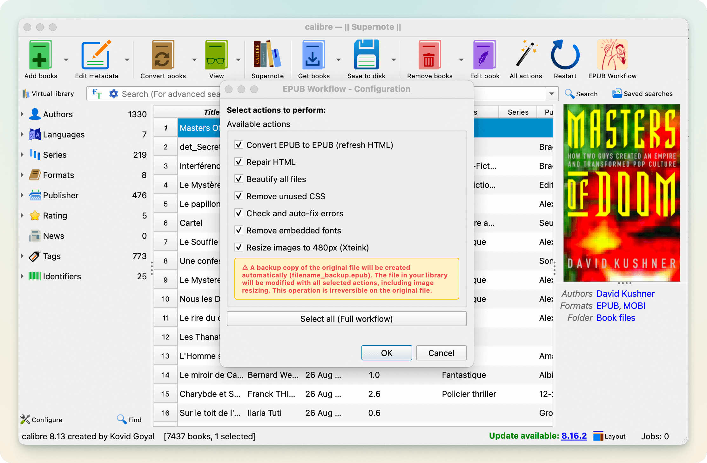

# EPUB Workflow for Calibre

**Clean up and optimize your EPUB files in one click, right from Calibre.**

EPUB Workflow is a Calibre plugin that chains Calibre's own polishing tools (repair, beautify, remove unused CSS, strip embedded fonts, resize images…) into a single, configurable action. Select one or many books, tick the steps you want, and let it run. It was built to get lighter, cleaner EPUBs for small e-ink readers like the Xteink.



> [!WARNING]
> Use with caution. The plugin should not break your EPUBs, but it can. A backup copy is created before every change.

## ✨ Features

- 🎯 **Simple interface**: pick the actions you want in a dialog, or select the full workflow, then click OK
- 📦 **Batch processing**: process as many EPUBs as you want in one go
- 🔄 **Automatic backup**: a copy (`filename_backup.epub`) is saved next to the original before any change
- 🌍 **English and French**: follows Calibre's interface language
- ⚡ **Fast**: built on Calibre's own polish tools
- 💻 **CLI version included**: a standalone script for batch jobs from the terminal (see [`Python-CLI`](Python-CLI/))

## 🔧 Available actions

| Action | What it does |
| --- | --- |
| **Convert EPUB to EPUB** | Refreshes the HTML by reconverting the EPUB |
| **Repair HTML** | Fixes HTML errors in the file |
| **Beautify** | Formats and indents HTML and CSS |
| **Remove unused CSS** | Removes CSS rules no page uses, to reduce file size |
| **Check and auto-fix errors** | Checks the book and automatically fixes the errors found |
| **Remove embedded fonts** | Removes embedded fonts, so your reader uses its own |
| **Resize images to 480px** | Resizes images to 480px wide, for Xteink e-readers (irreversible) |

## 📦 Installation

Requires **Calibre 6.0 or later**.

1. Download [`epub_workflow_plugin.zip`](epub_workflow_plugin.zip)
2. In Calibre, go to **Preferences** → **Plugins** → **Load plugin from file**
3. Select `epub_workflow_plugin.zip`
4. Restart Calibre

## 🚀 Usage

1. Select one or more EPUB books in your Calibre library
2. Click the **EPUB Workflow** icon in the toolbar (or add it via **Preferences** → **Interface** → **Toolbars**)
3. Tick the actions you want
4. Click **OK** to start processing

### Good to know

- The book in your library is modified in place with every selected action.
- The backup copy is overwritten if one already exists from a previous run.
- Image resizing cannot be undone, except by restoring the backup.
- `.kepub.epub` files are skipped automatically.
- Only EPUB files are processed. If you select another format, the plugin asks you to convert it to EPUB first.

## 💻 Python CLI version

Prefer the terminal, or need to process folders outside Calibre? The [`Python-CLI`](Python-CLI/) folder has a standalone, interactive script with single-file, batch and recursive modes. It uses Calibre's command-line tools under the hood. See its [readme](Python-CLI/readme.md) for setup.

## 📁 Repository structure

```
epub_workflow_plugin/        # Plugin source
├── __init__.py              # Plugin entry point
├── plugin.py                # Main plugin class
├── config_dialog.py         # Configuration dialog
├── progress_dialog.py       # Progress dialog
├── workflow_engine.py       # Processing engine
├── translations.py          # English and French strings
└── images/
    └── epub_workflow.png    # Plugin icon
epub_workflow_plugin.zip     # Ready-to-install plugin
Python-CLI/                  # Standalone command-line version
_OLD/                        # Previous standalone script, kept for reference
```

## 🤝 Contributing

Contributions are welcome! Feel free to open an issue or a pull request.

## 📄 License

GPL v3

## 👤 Author

**Florent Bertiaux** ([bertiaux.fr](https://bertiaux.fr), u/iamkxrz on Reddit), also behind [readme.club](https://www.readme.club), the e-ink media.
